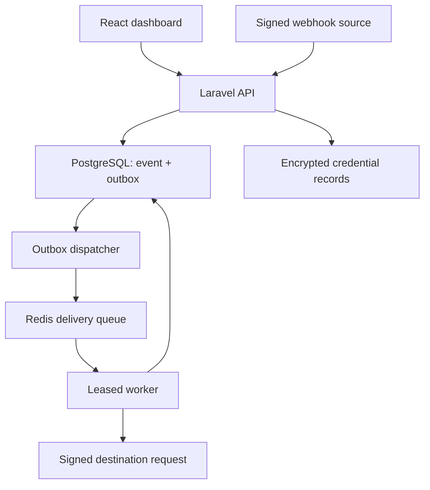

<div align="center">

# APIQENDRA
**One center. Every connection.**

API integration infrastructure with encrypted credentials, authenticated webhooks, durable delivery, and observable failure recovery.

PHP · Laravel · React · TypeScript · PostgreSQL · Redis · Docker

</div>

## Current state

**Local acceptance passed on 2026-10-29:** all 22 release gates, including locked clean installation, image builds, SQLite/PostgreSQL suites, UI/mobile and live security tests, dependency audits, broker/worker recovery, backup/restore, payload retention and a measured load baseline. See the [release evidence](docs/releases/LOCAL_ACCEPTANCE_2026-10-29.md). Source version is 0.1.0; Git publication, hosted CI and the intended release tag remain pending.

See [implementation status](docs/IMPLEMENTATION_STATUS.md) for evidence and [the automated release checklist](docs/RELEASE_CHECKLIST.md) for the publication handoff. To repeat local verification, run `powershell.exe -NoProfile -ExecutionPolicy Bypass -File .\infrastructure\scripts\Release.ps1` from a normal Docker-enabled terminal.

## What it does

- **Connect:** versioned GitHub, Slack, custom HTTPS, and local provider definitions; encrypted credential references; bounded request execution and sanitized diagnostics.
- **Relay:** raw-body HMAC verification, subscription filtering, immutable accepted events, transactional outbox, Redis jobs, fan-out, retry budgets, dead letters, and controlled replay.
- **Vault:** encrypted credential values and version history, expiry, rotation, revocation, and access audits.
- **Monitor:** persisted attempts, hourly traffic, success rate, p95 latency, request/ingress logs, CSV export, and deduplicated in-app alerts.
- **Simulation Lab:** actual signed source requests and signature-verifying destinations. Exercise success, 503 recovery, rate limits, stale/invalid signatures, duplicate events, fan-out, and uncertain timeouts.
- **Workspaces:** session authentication, isolated tenants, owner/admin/developer/viewer permissions, and email-bound one-time invitation tokens.

Apiqendra combines “API” with “qendra,” the Albanian word for center.

## Run locally on Windows

Use PowerShell 7, Git, Node 24, and Docker Desktop with the Linux engine. PHP and Composer are supplied by the tooling image.

```powershell
# From the repository root:
npm ci
npm --prefix apps/web ci
pwsh -File infrastructure/scripts/Setup.ps1 -Start
```

The first setup generates private secrets in `.env`, prepares framework directories, resolves `apps/api/composer.lock` when absent, builds images, runs migrations, and seeds a synthetic demo workspace. Initial dependency resolution requires internet access. **Review and commit the resulting Composer lockfile** before treating the checkout as reproducible.

Open **http://localhost:8084**. Read `DEMO_EMAIL` and `DEMO_PASSWORD` privately from `.env`. There are no committed default passwords. Change `HTTP_PORT` and `APP_URL` together if 8084 is occupied.

```powershell
docker compose ps
docker compose logs --tail=80 api worker dispatcher
```

PostgreSQL, Redis, API internals, and the simulator have no host port bindings. The web gateway is bound to loopback. This stack is designed for local review; public hosting is a separate hardening/deployment task.

## Try the complete demonstration

1. Sign in, or create an account; registration creates an owned sandbox workspace.
2. Open **Simulation Lab** and run **The golden path**.
3. Wait for **Verified outcome**. Inspect its delivery: signed ingress → durable event → mapped payload → HTTP 200.
4. Run **Recover from an outage**. It must record two 503 responses and succeed on attempt three.
5. Run **Keep duplicates harmless** and **Reject a forged event**. The first must yield one logical event/delivery; the second must be rejected at ingress.
6. Run **Dead letter & replay**. After four attempts, recover its destination and explicitly replay the delivery. The new run retains prior attempts and the same idempotency key.
7. Open **Monitor**, inspect records, and export the selected range.

These are acceptance targets until the live integration suite passes. UI test fixtures are confined to `tests/`; application dashboards read the API.

## Developer commands

```powershell
npm run dev                    # Vite, http://127.0.0.1:5184, API proxy to 8084
npm run check                  # source hygiene + TypeScript + contracts + production build
node --test apps/simulators/server.test.mjs
npx playwright install chromium
npm run test:e2e -- --project=ui --project=mobile
pwsh -File infrastructure/scripts/Verify.ps1
```

UI browser projects fulfill built assets and synthetic API fixtures in memory; run `npm run build` first. They verify rendering and interactions, **not** backend behavior. The integration project uses the actual Compose stack:

```powershell
npm run test:e2e -- --project=integration
docker compose --profile tools run --rm tooling php vendor/bin/phpunit
docker compose --profile tools run --rm tooling vendor/bin/pint
```

PHPUnit defaults to SQLite in isolation. `Verify.ps1` creates a separate PostgreSQL test database, never the demo database. CI has both database variants. See [verification guide](docs/runbooks/VERIFICATION.md).

## Architecture



The database owns durable intent; Redis accelerates execution. Expired leases and stale publishes are recoverable. Retries are at least once: a remote service can receive a request before the sender learns its outcome. Stable idempotency keys and honest uncertainty are part of the contract.

Details: [architecture](docs/architecture/OVERVIEW.md) · [security](SECURITY.md) · [ADRs](docs/adr/DECISIONS.md) · [API contract](packages/contracts/openapi.json).

## Repository

| Path | Responsibility |
| --- | --- |
| `apps/api` | Laravel domains, policies, persistence, queues, controllers, PHP tests |
| `apps/web` | React dashboard, forms, request builder, monitoring and simulation UI |
| `apps/simulators` | Isolated source and destination provider simulator |
| `packages/contracts` | OpenAPI 3.1 and Node signature verification helper |
| `infrastructure` | Dockerfiles, PowerShell scripts and optional monitoring |
| `tests` | Contracts, browser workflows, concurrency and k6 harnesses |
| `docs` | Sprint handoffs, runbooks, architecture and verification evidence |

## Operations

- Backup: `pwsh -File infrastructure/scripts/Backup.ps1`
- Restore: follow [backup/restore](docs/runbooks/OPERATIONS.md); confirmation is required because it replaces local data.
- Rotation and retention: [operations guide](docs/runbooks/OPERATIONS.md).
- Optional Prometheus/Grafana: [monitoring guide](docs/runbooks/MONITORING.md).
- Performance: [methodology](docs/runbooks/PERFORMANCE.md). No benchmark figures are claimed.

## Deliberate scope

Invitations use shareable one-time tokens; outbound email and OAuth are not configured. Live providers require your own least-privilege test credentials. There is no arbitrary code execution in mappings, unrestricted network proxy, exactly-once guarantee, compliance certification, or public deployment in this release target.

The complete source roadmap and per-sprint learning notes are retained in the repository. Licensed under MIT.
