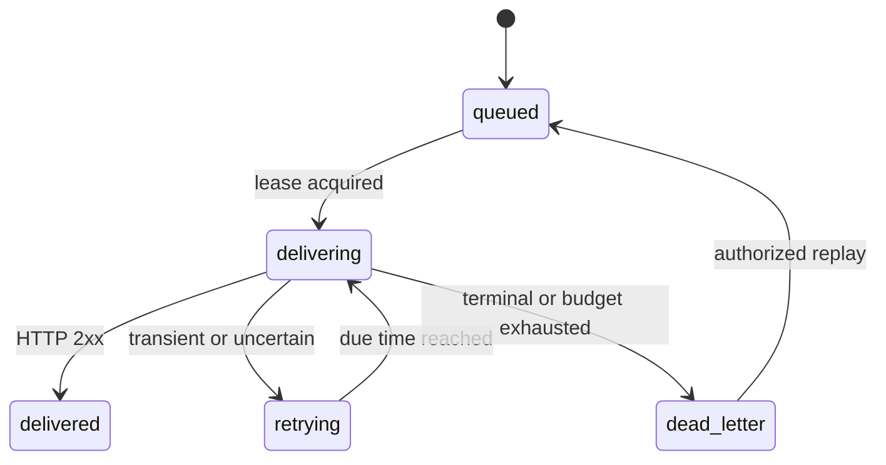

# Architecture

## Domain ownership

Laravel is a modular monolith. Domain code lives under `app/Domain`, controllers translate HTTP inputs, Eloquent models represent persisted facts, and jobs handle bounded delivery work. API, worker, dispatcher and scheduler use the same source/image and can scale independently.

| Domain | Responsibilities |
| --- | --- |
| Identity | Session login, registration, role capabilities |
| Workspaces | Membership, related-resource authorization, invitation redemption |
| Connect | Provider definitions, safe outbound execution, request logs |
| Vault | Encrypted values and versions, redaction, rotation and re-encryption |
| Relay | Signatures, ingress, mapping, retry policy, transactional outbox |
| Monitor | Aggregates, delivery inspection, alerts, exports and internal metrics |
| Audit | Configuration, use, denial, replay and security activity records |

## Ingress transaction

1. Resolve the opaque endpoint ID.
2. Verify subscription, raw-body signature, content type, size and source ID.
3. Check for an existing endpoint/source ID; a changed body for that ID is a conflict.
4. Lock the workspace row to serialize quota checks.
5. Insert the encrypted immutable event, redacted preview, one delivery per distinct active routed destination, and one outbox row per delivery in the same database transaction.
6. Return 202 only after commit. A matching duplicate returns 200.

Ingress identity is **endpoint ID + source event ID**. Separate endpoints intentionally have independent identity domains. Generic sources must put the same stable ID in the signed body and header. GitHub additionally uses signed-body hashes to deduplicate changed delivery headers. There is no heuristic time-window identity fallback.

## Durable dispatch

The dispatcher reads due outbox rows, locks each row, publishes its delivery ID to Redis before marking the row dispatched, and commits. A publish failure rolls back the marker. A crash after publish can duplicate a job; delivery leasing makes duplicates harmless to local state.

Stale publishes older than 60 seconds are re-enqueued from PostgreSQL when their delivery is nonterminal and has no active lease. This also recovers jobs lost during a broker outage. The outbox is not deleted after enqueue.

## Delivery state machine

An attempt is persisted as sending **before** the HTTP call. Completion requires the same lease token. After a crashed worker's lease expires, its previous sending attempt becomes uncertain before another attempt starts.

Four attempts are allowed per run. Retry delays are exponential with small jitter, capped at 120 seconds, with bounded Retry-After handling. Replay increments generation and resets only the per-run budget. Attempt numbers and delivery identity remain stable.

Mappings are snapshotted into delivery records at event acceptance. Destination URLs and credentials are looked up at send time so an operator can repair a destination before replay. Signing secret rotation is immediate; no old-key grace window is implied.

## Data and privacy

Credentials also carry an owner/admin-controlled exact-host allowlist, checked before the decrypted value is placed in a request header.

Tenant resources include workspace IDs; related foreign IDs are validated inside that workspace. Database uniqueness provides a final concurrency boundary for ingress, fan-out and attempt numbers. Shared workers do not use request-local tenant globals.

Event payloads and secrets are encrypted. Preview data is key-redacted. Retention removes payload data while retaining identifiers and attempt history; purged events cannot be replayed.

The application key is shared across the installation. Workspace-level access isolation is implemented, but per-tenant key management is outside this local release scope.

## Metrics definitions

- Events: accepted persisted events created in the selected range.
- Attempt success: delivered completed attempts / all completed attempts.
- p95: database latency percentile over completed attempts, including failed outcomes.
- Delivery status counts: current state of deliveries created in the selected range.
- Queue backlog: current queued/retrying/delivering jobs across all time.
- Hourly traffic: grouped by attempt creation time in UTC; the UI fills empty hours with zero.

These metrics are database facts, not external uptime claims. Prometheus gauges are separately authenticated and not forwarded by the web gateway.

## Operational constraints

Ingress is limited to 120 accepted events per workspace per minute; HTTP middleware also limits endpoint traffic. Connectors allow 30 executions per minute; delivery workers allow 60 sends per workspace per minute. These bounds reduce noisy-neighbor pressure; they are not a weighted fair scheduler.

The local setup includes one worker by default. Public production deployment, dedicated egress firewall policy, TLS termination, an external secret manager, mail delivery, OAuth and strong per-tenant infrastructure isolation are later tasks.
